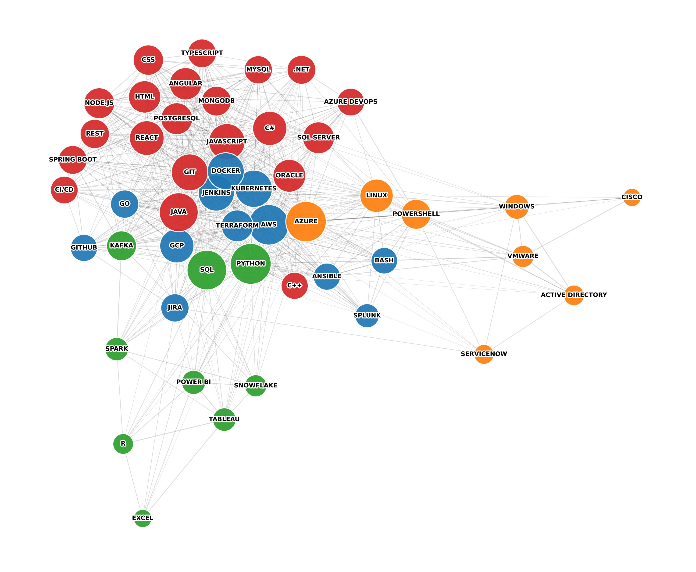

# Analysis of the IT Job Market Using Large Language Models and Network Methods

Code for my bachelor's thesis at the Faculty of Organizational Sciences, University of Belgrade (mentor prof. dr Jelena Jovanović). The thesis grew out of a project for the Advanced Data Analysis course. The notebooks and the thesis are in Serbian.

[Srpska verzija](README.md)

Question: a candidate knows a few technologies, what is worth learning next? The answer comes from job postings. A large language model extracts the required technologies from the free text of each posting. These form a network of technologies that are asked for together, and several models that suggest the next technology are compared on top of it.

## Data

[LinkedIn Job Postings (2023 - 2024)](https://www.kaggle.com/datasets/arshkon/linkedin-job-postings) from Kaggle, license CC BY-SA 4.0. It contains 123,849 postings, almost all from April 2024, for the US market.

| Step | Postings |
|---|---:|
| All postings | 123,849 |
| After filtering by LinkedIn job function and job title | 15,306 |
| After removing identical copies | 14,156 |
| After the language model's decision that the posting is an IT job | 11,713 |

## Results in short

- The language model is `gpt-oss-20b` via Groq, with responses in a fixed schema (Pydantic, structured output). Processing all postings cost $3.01.
- Manual check of the IT filter on 50 random postings: precision 0.902, recall 1.000.
- The network has 189 technologies and 1,260 edges, weighted by lift. Louvain found 14 clusters with modularity 0.640. The partition was chosen as the typical outcome of 100 runs.
- Hubs (Python, AWS, Java, SQL) are connected to almost every area. Bridges with few links (Cisco, Active Directory, DB2) connect one narrow area to the rest of the network.
- Recommendations were evaluated by hiding one technology from a posting and checking whether the model returns it among ten suggestions. The data is split by company, so no company appears in both training and evaluation.

| Model | recall@10 | Coverage |
|---|---:|---:|
| popularity | 0.348 | 7.3 % |
| Apriori | 0.565 | 33.1 % |
| lift similarity | 0.355 | 99.3 % |
| hybrid model | 0.600 | 97.6 % |



## Notebooks

| Notebook | Contents |
|---|---|
| [01_ekstrakcija.ipynb](01_ekstrakcija.ipynb) | IT filtering, model choice, technology extraction, effect of description length, manual check of the filter |
| [02_analiza.ipynb](02_analiza.ipynb) | name canonicalization, technology network, centrality, hubs and bridges, clusters |
| [03_preporuka.ipynb](03_preporuka.ipynb) | popularity, Apriori, lift similarity, hybrid model, evaluation on five company splits |
| [04_plate.ipynb](04_plate.ipynb) | additional salary analysis by technology, not part of the thesis |

Run the notebooks in order, since each one reads what the previous one wrote to `data/interim/`.

## Other folders

- `figures/`: all figures from the notebooks.
- `validacija/`: the sample of 50 postings with manual labels and the labeling instructions.
- `data/interim/`: saved language model responses (`ekstrakcija_*.jsonl`), so the notebooks do not need to call the model again.
- `arhiva/`: the first version of the course project, with `llama-3.3-70b` and a sample of 1,460 postings.

## Running

```bash
python -m venv .venv
source .venv/bin/activate
pip install -r requirements.txt
cp .env.example .env
```

Put the CSV files from Kaggle directly into `data/raw/`, without subfolders. The notebooks use `postings.csv`, `job_skills.csv`, `salaries.csv` and `companies.csv`.

The model responses are already in `data/interim/`, so notebook 01 sends no new requests and a real Groq key is not needed. A key in `.env` is only needed to process postings that are not in the cache.
